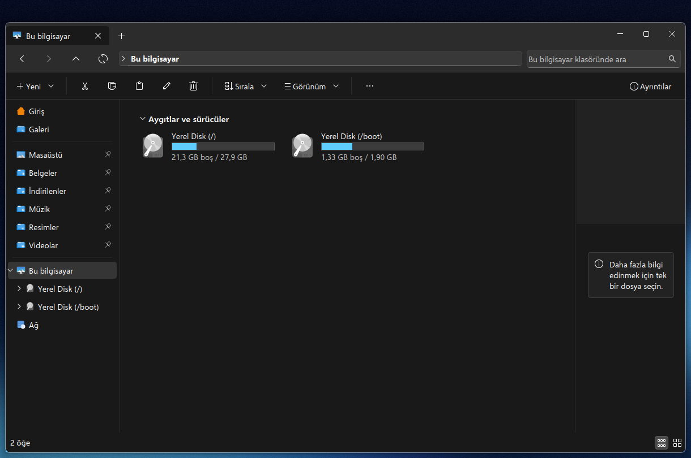

# Bridge Files

**A file manager for Linux that feels like the one you left on Windows.**

[Türkçe](README.tr.md)

Bridge Files is a modified [Dolphin](https://apps.kde.org/dolphin/) for KDE Plasma 6. It keeps
Dolphin's engine (KIO, its views and file operations) and rearranges everything you see to match
File Explorer on Windows 11. A Windows 7 look is one setting away.

It is meant for people moving from Windows to Linux. Moving files, opening folders and finding
things should work the way your hands already expect, so you can learn the rest of Linux at
your own pace.

It installs next to the system Dolphin and does not touch it: it has its own settings file, its
own app id and its own launcher, called **File Explorer**.


| Windows 11, light | Windows 7, light |
|---|---|
|  |  |

| Windows 7 menu | Windows 7, dark |
|---|---|
|  |  |

| Copy dialog | Classic copy dialog |
|---|---|
|  |  |



The screenshots show the Turkish interface. Every string of the app is in English, with a full
Turkish translation.

## What is different from Dolphin

**Windows 11 look (default)**

- Tabs in the title bar, with a "+" button and the window buttons on the same row.
- An address row with back, forward, up and refresh, a breadcrumb path, and a search box.
- A command bar: New, Cut, Copy, Paste, Rename, Delete, Sort, View, "See more" and Details.
- A navigation pane with Home, Gallery, pinned folders, This PC (with "Local Disk (/)", the root
  folder, always first) and Network.
- A Home page with Quick access, Favorites and Recent files.
- A This PC page: "Devices and drives" as tiles with a capacity bar and "X GB free of Y GB". A drive
  that is not mounted yet is mounted when you open it; removable drives can be ejected from the
  right-click menu.
- A Network page: your network adapters (state, IP and MAC address), the router, and the
  computers, media devices, printers and other devices on your network. A double click opens a
  computer's shared files (SMB or SFTP) or a device's web page. Devices are found through
  avahi (DNS-SD), so install `avahi-tools` if the page says it is missing.
- The details view opens by default, with Name, Date modified, Type and Size columns, and type
  names you know ("File folder", "Text Document", "Compressed (zipped) Folder").
- A short right-click menu with the common actions in an icon row at the top, and "Copy as path"
  (Ctrl+Shift+C).
- A copy, move and delete window that shows "N% complete" with a speed graph, pause and cancel.
  A classic layout can be chosen instead.
- A plain drop onto another drive copies the files straight away, with no menu asking what to do.

**Windows 7 look (optional)**

Settings > Interface > Folders & Tabs > Look: Windows 7. It takes effect the next time File
Explorer starts.

- Glass title area, round back and forward buttons, and an Organize menu with New folder.
- A navigation pane grouped into Favorites, Libraries, Computer and Network. Computer opens the
  same drives page, titled Computer.
- Windows 7 selection boxes, column headers and menus.
- A details pane below the files, and the classic copy window.

## Requirements

- KDE Plasma 6.3 or newer (for KDecoration3), Qt 6.4 or newer, KDE Frameworks 6.23 or newer.
- Tested only on **Fedora 44 KDE** (Plasma 6.7.5, Qt 6.11, Frameworks 6.31, Wayland). Other
  distributions with recent enough Plasma should work but have not been tried.

## Build dependencies

On Fedora, the packages Dolphin itself is built with, plus the window decoration headers:

```bash
sudo dnf builddep dolphin
sudo dnf install git cmake ninja-build gcc-c++ extra-cmake-modules kdecoration-devel kf6-kcoreaddons-devel
```

On other distributions, install the development packages of Dolphin's dependencies (KIO,
KXmlGui, KBookmarks, KNewStuff, Baloo and the other KF6 libraries) and of KDecoration3.

## Install

Everything goes into your home folder. No sudo is needed.

```bash
git clone https://github.com/furkan-karapinar/bridge-files.git
cd bridge-files
./install.sh
```

Then start **File Explorer** from the app menu.

What `install.sh` does:

- **Qt style.** Builds the widget style that draws the Windows 11 and Windows 7 looks.
- **Window frame.** Builds the frame that lets the tabs sit in the title bar.
- **App.** Builds the app into `~/.local/opt/shellkit-files` and adds the launcher.

The frame is optional:

- Skip it with `./install.sh --no-frame`. You then get your normal title bar above the tabs.
- To use it, pick **Windows 11 (shellkit)** in System Settings > Colors & Themes > Window
  Decorations, after signing out and in once.
- Or run `./install.sh --use-frame`, which saves your current decoration and switches to it.

The frame then applies to every window.

To remove everything (your File Explorer settings are kept):

```bash
./uninstall.sh
```

## Looks closer with

The screenshots use these, installed separately:

- the [Fluent icon theme](https://github.com/vinceliuice/Fluent-icon-theme) (GPL-3.0);
- the [Selawik](https://github.com/microsoft/Selawik) font (OFL).

The app itself follows your system colours, icons and fonts.

## Known limitations

- Some KDE dialogs (Properties, the settings window) keep their KDE layout.
- The Network page sees only devices that announce themselves over mDNS/DNS-SD or that talked
  to your computer lately. Windows PCs show up only if they announce themselves that way.
- "Copy to" and some deletions outside the file view still report progress as a Plasma
  notification instead of the copy window.
- In the Windows 7 look, the preview pane keeps the Dolphin layout and Libraries are your user
  folders, not real libraries.
- Internally the app is still called `shellkit-files` (binary, settings file `shellkit-filesrc`,
  app id `org.shellkit.files`). It started as part of a larger project, shellkit.

## How it is built

`app/` is Dolphin 26.08.1 with the changes listed in [app/FORK.md](app/FORK.md). The changes are
kept small and marked, so a newer Dolphin can be merged. `style/` is a Qt Widgets style plugin on
top of Fusion. `decoration/` is a KWin window decoration. It hides its title bar only for File
Explorer windows, which draw their own buttons next to the tabs.

No Microsoft code, icons or fonts are included. The window buttons, arrows and other details are
drawn in code.

## License

GPL-2.0-or-later, as Dolphin. See [LICENSE](LICENSE). Dolphin's own files keep their original
copyright and license headers (`app/LICENSES`).

Windows is a trademark of Microsoft Corporation. Bridge Files is not affiliated with or endorsed
by Microsoft or KDE.
