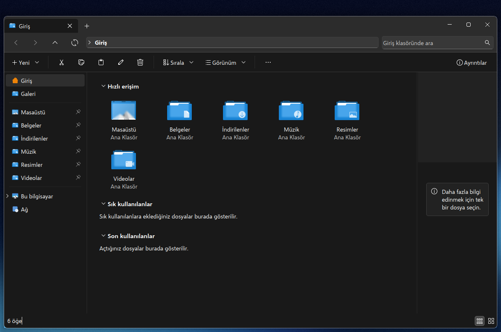
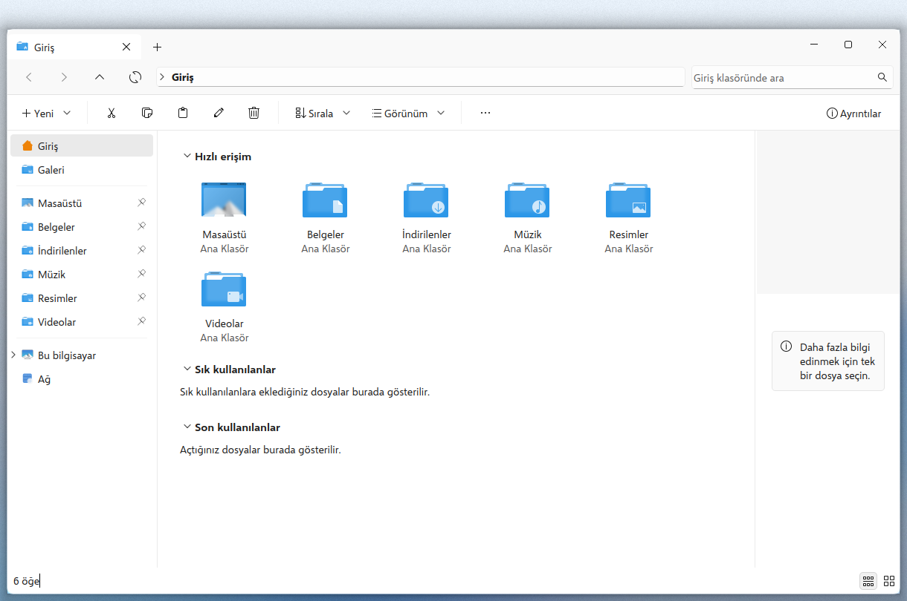
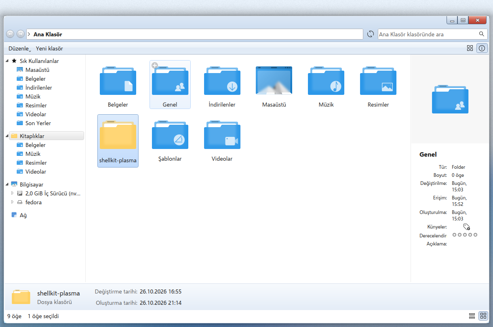
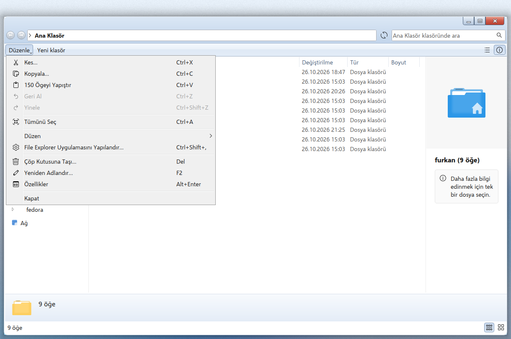
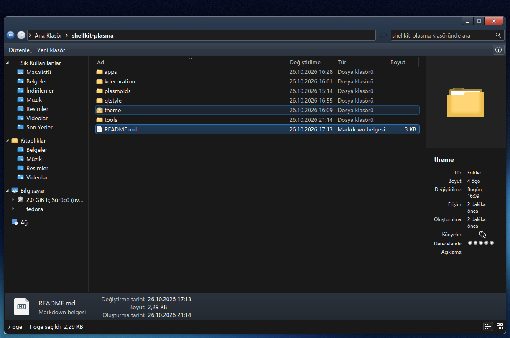
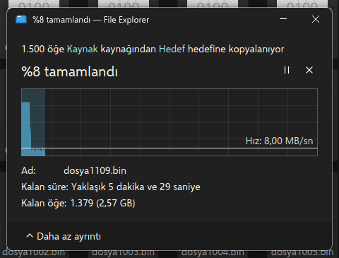
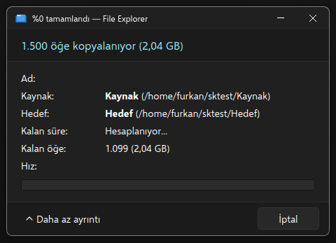

# Bridge Files

**Linux için, Windows'ta bıraktığın dosya gezginine benzeyen bir dosya yöneticisi.**

[English](README.md)

Bridge Files, KDE Plasma 6 için değiştirilmiş bir [Dolphin](https://apps.kde.org/dolphin/).
Dolphin'in altyapısını (KIO, görünümler, dosya işlemleri) olduğu gibi kullanır. Gördüğün her şeyi
ise Windows 11 Dosya Gezgini'ne göre yeniden düzenler. İstersen tek bir ayarla Windows 7
görünümüne geçebilirsin.

Windows'tan Linux'a geçenler için yapıldı. Dosya taşımak, klasör açmak ve bir şey aramak
alıştığın gibi çalışsın, Linux'un geri kalanını da kendi hızında öğren diye.

Sistemdeki Dolphin'in yanına kurulur ve ona dokunmaz. Ayar dosyası, uygulama kimliği ve
**Dosya Gezgini** adlı başlatıcısı kendine aittir.



| Windows 11, açık | Windows 7, açık |
|---|---|
|  |  |

| Windows 7 menüsü | Windows 7, koyu |
|---|---|
|  |  |

| Kopyalama penceresi | Klasik kopyalama penceresi |
|---|---|
|  |  |

## Dolphin'den farkı

**Windows 11 görünümü (varsayılan)**

- Sekmeler başlık satırında. "+" düğmesi ve pencere düğmeleri de aynı satırda.
- Adres satırında geri, ileri, yukarı ve yenile düğmeleri, tıklanabilir yol ve arama kutusu var.
- Komut çubuğunda Yeni, Kes, Kopyala, Yapıştır, Yeniden adlandır, Sil, Sırala, Görünüm,
  "Daha fazlasını gör" ve Ayrıntılar düğmeleri var.
- Gezinti bölmesinde Giriş, Galeri, sabitlenmiş klasörler, Bu bilgisayar ve Ağ bulunur.
- Giriş sayfasında Hızlı erişim, Sık kullanılanlar ve Son kullanılanlar bulunur.
- Klasörler varsayılan olarak ayrıntılar görünümünde açılır. Ad, Değiştirme tarihi, Tür ve Boyut
  sütunları gösterilir. Tür adları alıştığın gibidir: "Dosya klasörü", "Metin Belgesi",
  "Sıkıştırılmış (zip) Klasör".
- Sağ tık menüsü kısadır. Sık kullanılan işlemler en üstte simge satırında durur. "Yol olarak
  kopyala" da vardır (Ctrl+Shift+C).
- Kopyalama, taşıma ve silme penceresi "%N tamamlandı" yazar, hız grafiği gösterir, duraklatma
  ve iptal düğmeleri vardır. İstersen klasik düzeni seçebilirsin.
- Başka bir sürücüye bırakılan dosyalar menü sormadan kopyalanır.

**Windows 7 görünümü (isteğe bağlı)**

Ayarlar > Arayüz > Klasörler ve Sekmeler > Görünüm: Windows 7. Dosya Gezgini bir sonraki
açılışında uygulanır.

- Cam görünümlü başlık alanı, yuvarlak geri ve ileri düğmeleri var. Düzenle menüsü ve Yeni klasör
  düğmesi de bulunur.
- Gezinti bölmesi Sık Kullanılanlar, Kitaplıklar, Bilgisayar ve Ağ gruplarına ayrılır.
- Seçim kutuları, sütun başlıkları ve menüler Windows 7'deki gibidir.
- Dosyaların altında ayrıntılar bölmesi bulunur. Kopyalama penceresi klasik düzendedir.

## Gereksinimler

- KDE Plasma 6.3 ya da daha yenisi (KDecoration3 için), Qt 6.4 ya da daha yenisi, KDE
  Frameworks 6.23 ya da daha yenisi.
- Yalnız **Fedora 44 KDE** üzerinde denendi (Plasma 6.7.5, Qt 6.11, Frameworks 6.31, Wayland).
  Plasma'sı yeterince yeni olan başka dağıtımlarda da çalışması beklenir, ama denenmedi.

## Derleme bağımlılıkları

Fedora'da Dolphin'in derlendiği paketlerle pencere çerçevesi başlıklarını kur:

```bash
sudo dnf builddep dolphin
sudo dnf install git cmake ninja-build gcc-c++ extra-cmake-modules kdecoration-devel kf6-kcoreaddons-devel
```

Başka dağıtımlarda Dolphin'in bağımlılıklarının geliştirme paketlerini kur (KIO, KXmlGui,
KBookmarks, KNewStuff, Baloo ve diğer KF6 kütüphaneleri). KDecoration3'ün geliştirme paketi de
gerekir.

## Kurulum

Her şey ev klasörüne kurulur. sudo gerekmez.

```bash
git clone https://github.com/furkan-karapinar/bridge-files.git
cd bridge-files
./install.sh
```

Sonra uygulama menüsünden **Dosya Gezgini**'ni aç.

`install.sh` şunları yapar:

- **Qt stili.** Windows 11 ve Windows 7 görünümlerini çizen stili derler.
- **Pencere çerçevesi.** Sekmelerin başlık satırına yerleşmesini sağlayan çerçeveyi derler.
- **Uygulama.** Uygulamayı `~/.local/opt/shellkit-files` klasörüne derler ve başlatıcıyı ekler.

Çerçeve isteğe bağlıdır:

- Kurmak istemezsen `./install.sh --no-frame` çalıştır. O zaman sekmelerin üstünde normal başlık
  çubuğun kalır.
- Kullanmak için bir kez oturumu kapatıp aç. Sonra Sistem Ayarları > Renkler ve Temalar >
  Pencere Dekorasyonları'ndan **Windows 11 (shellkit)** seç.
- Ya da `./install.sh --use-frame` çalıştır. Bu komut mevcut dekorasyonunu yedekler ve çerçeveye
  geçer.

Seçtiğin çerçeve bütün pencerelere uygulanır.

Hepsini kaldırmak için (Dosya Gezgini ayarların kalır):

```bash
./uninstall.sh
```

## Daha da benzetmek için

Ekran görüntülerinde ayrıca kurulmuş şunlar kullanıldı:

- [Fluent simge teması](https://github.com/vinceliuice/Fluent-icon-theme) (GPL-3.0);
- [Selawik](https://github.com/microsoft/Selawik) yazı tipi (OFL).

Uygulamanın kendisi sistemindeki renkleri, simgeleri ve yazı tiplerini kullanır.

## Bilinen eksikler

- Bazı KDE pencereleri (Özellikler, ayarlar penceresi) KDE düzeninde kalır.
- "Şuraya kopyala" ve dosya görünümü dışındaki bazı silmelerin ilerlemesi kopyalama penceresi
  yerine Plasma bildiriminde görünür.
- Windows 7 görünümünde önizleme bölmesi Dolphin düzenindedir. Kitaplıklar gerçek kitaplık
  değildir, kullanıcı klasörlerine bağlanır.
- Uygulamanın iç adı hâlâ `shellkit-files`: program, ayar dosyası (`shellkit-filesrc`) ve
  uygulama kimliği (`org.shellkit.files`) bu adı taşır. Proje, shellkit adlı daha büyük bir
  çalışmanın parçası olarak başladı.

## Nasıl yapıldı

`app/` klasörü Dolphin 26.08.1'dir. Değişiklikler [app/FORK.md](app/FORK.md) dosyasında
listelenir. Değişiklikler küçük tutuldu ve işaretlendi, böylece Dolphin'in yeni sürümleri
birleştirilebilir.

- `style/`: Fusion üstüne bir Qt Widgets stil eklentisi.
- `decoration/`: bir KWin pencere çerçevesi. Başlık çubuğunu yalnız Dosya Gezgini pencerelerinde
  gizler, çünkü bu pencereler düğmelerini sekmelerin yanına kendileri çizer.

İçinde Microsoft'a ait kod, simge ya da yazı tipi yok. Pencere düğmeleri, oklar ve diğer
ayrıntılar kodla çizildi.

## Lisans

Dolphin gibi GPL-2.0-or-later. Bkz. [LICENSE](LICENSE). Dolphin'in kendi dosyaları özgün telif ve
lisans başlıklarını korur (`app/LICENSES`).

Windows, Microsoft Corporation'ın ticari markasıdır. Bridge Files'ın Microsoft ya da KDE ile bir
bağı yoktur ve onlar tarafından desteklenmez.
